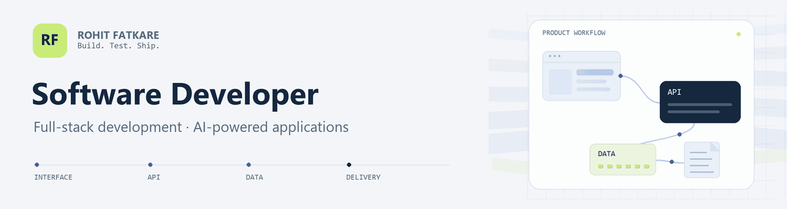

<picture>
  <source media="(prefers-reduced-motion: reduce)" srcset="./assets/profile-banner.png">
  
</picture>

### Full Stack Developer at [Digitrix Agency](https://digitrix.agency/)

I build full-stack web applications for billing, receipt creation and AI-assisted document processing. My work spans interfaces, APIs, data and integrations, through testing and deployment.

  
  
  

## Selected product work

These are company products I have contributed to at Digitrix.

### HopeOF

Billing and receipt forms, editable templates, live previews and authentication. I also implemented Razorpay payments and subscriptions, Excel bulk import/export and PDF generation.

[Read the case study](https://rohitfatkare.vercel.app/case-studies/hopeof) · [Visit the product](https://hopeof.com/)

### AI Bank Statement Converter

I extended an existing product with application workflows, Tools and Banks sections, bank-specific pages, multilingual support and multi-format exports. My work also includes OCR processing and recovery, data mapping, manual and AI-assisted statement editing, and an AI Assistant.

[Read the case study](https://rohitfatkare.vercel.app/case-studies/ai-bank-statement-converter) · [Visit the product](https://aibankstatementconvertor.com/)

### Create Receipt

Receipt templates, localized forms, customization and live previews. I also worked on saved-receipt editing, subscription and account APIs, shared exports and QA-reported bug fixes.

[Read the case study](https://rohitfatkare.vercel.app/case-studies/create-receipt) · [Visit the product](https://createreceipt.com/)

> **From development to deployment:** I created and implemented CI/CD setups for HopeOF and AI Bank Statement Converter, tested application workflows and handled deployments to staging and production.

## Technologies I use

  
  
  
  
  
  
  

**Frontend:** Next.js, React, TypeScript, JavaScript, Tailwind CSS, Material UI and Redux.

**Backend and data:** Node.js, Python, FastAPI, MongoDB, Mongoose and REST APIs.

**Integrations and delivery:** NextAuth, Stripe, Razorpay, Puppeteer, ExcelJS, Git, GitHub, Vercel, CI/CD, testing and debugging.

## My journey and next steps

- **Full Stack Developer, Digitrix Agency:** November 2025 to present.
- **Full Stack Developer Intern, Digitrix Agency:** May 2025 to November 2025.
- **MSc in Computer Science:** Annasaheb Vartak College, completed in 2026.

I'm deepening my backend development skills and growing in AI engineering, system design and reliable, scalable software. I'm interested in Software Developer opportunities where I can contribute to useful products and continue learning through hands-on engineering.

Explore my [personal portfolio](https://rohitfatkare.vercel.app/), [view my resume](https://rohitfatkare.vercel.app/api/resume), or reach me at [fatkarerohit05@gmail.com](mailto:fatkarerohit05@gmail.com).
